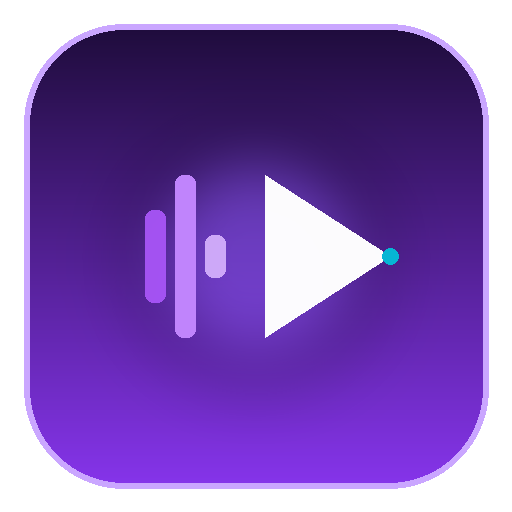
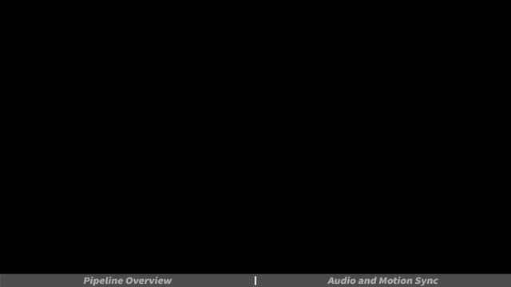
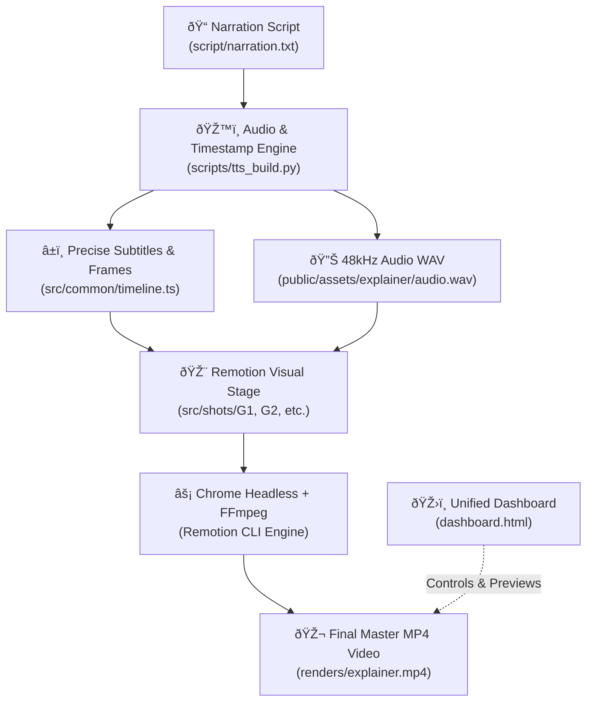

<div align="center">



# 🎬 AI Creative Studio
### Autonomous "Video-as-Code" Motion Graphics & Audio Synthesis Engine

[](https://www.typescriptlang.org/)
[](https://www.remotion.dev/)
[](https://react.dev/)
[](https://python.org/)
[](LICENSE)

<br/>



<br/>
<br/>

**Topic in, fully narrated 4K 60FPS motion-graphics explainer video out.**  
*Every single frame is drawn programmatically in code using Remotion, synchronized with 48kHz expressive neural text-to-speech voiceovers and frame-perfect subtitles.*

</div>

---

## 🌟 Key Features

### 1. 🎥 Code-Driven Motion Graphics ("Video as Code")
* Built on **Remotion 4** and **React 19**: Create animations with components, CSS flexbox, SVGs, and mathematical easing formulas.
* **Deterministic Rendering:** 100% pixel-perfect frames at 1280×720 or 4K 60FPS without AI hallucinations, morphing artifacts, or video diffusion blur.
* **Animated Elements:** Includes glowing backdrop matrices, dynamic audio waveforms, procedural connection graphs, and HUD tech capsules.

### 2. 🎙️ 48kHz Neural Voiceover & Subtitle Alignment
* Integrated with **EdgeTTS**, **Soundfile**, and **Numpy** for studio-quality voice generation.
* **Millisecond Word Boundaries:** Automatically computes the exact spoken timestamp for every sentence and word, writing synchronized timeline markers to `src/common/timeline.ts` and `src/common/subs.ts`.
* Multi-Voice & Multi-Language Support (English, Chinese, Spanish, etc.).

### 3. 🎛️ Unified Browser Control Dashboard (`dashboard.html`)
* A single, modern control center allowing you to:
  * Preview rendered MP4 videos and scrub through timelines.
  * Live-edit narration scripts and chapter splits.
  * Switch voices and configure video dimensions and background styles.
  * Inspect motion design principles and trigger one-click render actions.

### 4. âš¡ One-Click PowerShell Workflow Runner (`.\run.ps1`)
* No complex CLI arguments to remember. Control the full lifecycle with clean single-word commands:
  ```powershell
  .\run.ps1 voice     # Synthesize voiceover & build subtitle timeline
  .\run.ps1 studio    # Launch interactive Remotion Studio web preview (localhost:3000)
  .\run.ps1 render    # Render the full production MP4 video
  .\run.ps1 preview   # Render a fast 60-frame preview
  .\run.ps1 typecheck # Verify TypeScript compilation
  ```

### 5. 🎨 Built-In Motion Design Rules (LottieFiles Principles)
* Incorporates Disney's 12 principles of animation adapted for modern digital UI:
  * **Cubic-Bezier Easing:** No stiff linear animations; utilizes natural deceleration (`cubic-bezier(0.16, 1, 0.3, 1)`).
  * **Visual Focal Hierarchy:** Strict 1-hero rule per scene with glowing purple highlights.
  * **Hold Pacing:** 30–45 frame post-arrival pauses before scene transitions.

### 6. 📱 Desktop App Shortcut & Multi-Resolution Icon
* Bundled with a custom-designed, multi-resolution (`16x16` to `256x256`) `.ico` icon and desktop launcher for instant access.

---

## 🏗️ Architecture & Pipeline Flow



---

## 📁 Repository Structure

```
ai-video-studio/
├── assets/                   # README images & animated demo GIF
│   ├── demo.gif              # Animated preview showcase
│   └── logo.png              # High-resolution studio icon
├── dashboard.html            # 🌟 Unified Browser Control Hub
├── public/                   # Static assets
│   ├── assets/explainer/     # Generated 48kHz audio tracks
│   └── fonts/                # Audiowide, Noto Sans, JetBrains Mono
├── script/                   # Storyboard & Narration inputs
│   ├── narration.txt         # Markdown script with chapters and subtitle pipes (|)
│   └── timeline.json         # Generated timeline metadata
├── scripts/                  # Automated toolchain scripts
│   ├── tts_build.py          # Voice synthesis & millisecond word boundary alignment
│   ├── motion_check.py       # Pacing & static element validator
│   └── frame_metrics.py      # Scene composition quality checker
├── src/                      # Video-as-Code Compositions
│   ├── config.ts             # Video metadata (Title, slug, language, HUD, background)
│   ├── Root.tsx              # Remotion Root registering compositions
│   ├── Main.tsx              # Stage coordinator (audio, background, shots, subtitles)
│   ├── ui.tsx                # Primitives (palette, arrows, glow, cards, animations)
│   ├── common/               # DotField wave, StarField, Subtitles, Progress bar
│   └── shots/                # Animated Scene Modules
│       ├── G1/index.tsx      # Chapter 1: AI Studio Hub & architecture flow
│       └── G2/index.tsx      # Chapter 2: Audio waveform & timestamp sync
├── run.ps1                   # One-click workflow runner
├── studio.ico                # High-resolution multi-layer Windows icon
└── remotion.config.ts        # Remotion engine rendering configurations
```

---

## 🚀 Quick Start Guide

### 1. Prerequisites
Ensure you have the following installed on your machine:
* **Node.js**: v20 or v22 LTS ([nodejs.org](https://nodejs.org/))
* **Python**: 3.10+ ([python.org](https://python.org/))
* **FFmpeg**: ([ffmpeg.org](https://ffmpeg.org/) or `winget install Gyan.FFmpeg`)
* **Git**

### 2. Installation
```powershell
# Clone the repository
git clone https://github.com/engineerpk38-rgb/AI_CREATIVE_STUDIO_HUB.git
cd AI_CREATIVE_STUDIO_HUB

# Install Python audio prerequisites
pip install edge-tts soundfile numpy

# Install Remotion & React dependencies
npm install
```

### 3. Usage

#### Step A: Write Your Narration Script
Open `script/narration.txt` and write your script. Use `# CHAPTER` for chapter cards and `|` to break subtitles:
```text
# CHAPTER 1 Pipeline Overview
Welcome to the autonomous AI video studio, | where code and narration come together.
Every graphic is rendered programmatically, | synchronized with crystal-clear audio.

# CHAPTER 2 Audio and Motion Sync
Text-to-speech voiceovers generate precise timestamps, | aligning subtitles down to the exact frame.
From concept to finished MP4 video, | the entire workflow runs completely in code.
```

#### Step B: Generate Voice & Subtitle Timestamps
```powershell
.\run.ps1 voice
```

#### Step C: Preview in Live Browser Studio
```powershell
.\run.ps1 studio
```
Navigate to `http://localhost:3000` to scrub through your composition interactively.

#### Step D: Render Production MP4 Video
```powershell
.\run.ps1 render
```
Your final video will be generated at `renders/explainer.mp4`.

---

## 🎛️ Unified Control Center (`dashboard.html`)
Double-click `dashboard.html` or launch it via PowerShell:
```powershell
Start-Process dashboard.html
```
The dashboard provides a zero-terminal interface to review videos, inspect scenes, and monitor production status.

---

## 📄 License
This project is open-source under the [MIT License](LICENSE).

---

<div align="center">
  <b>Built with ❤️ by Ali Hassan using Remotion, EdgeTTS, and Antigravity</b>
</div>
