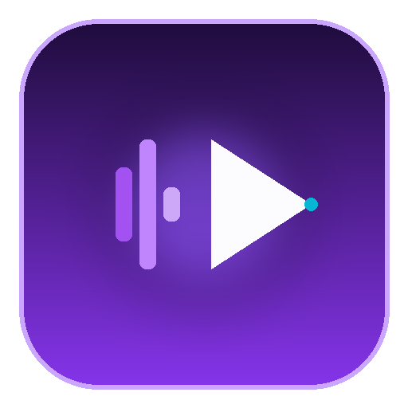
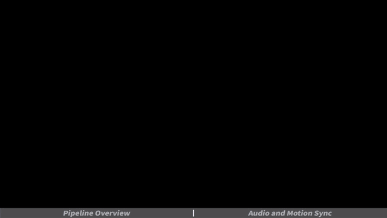
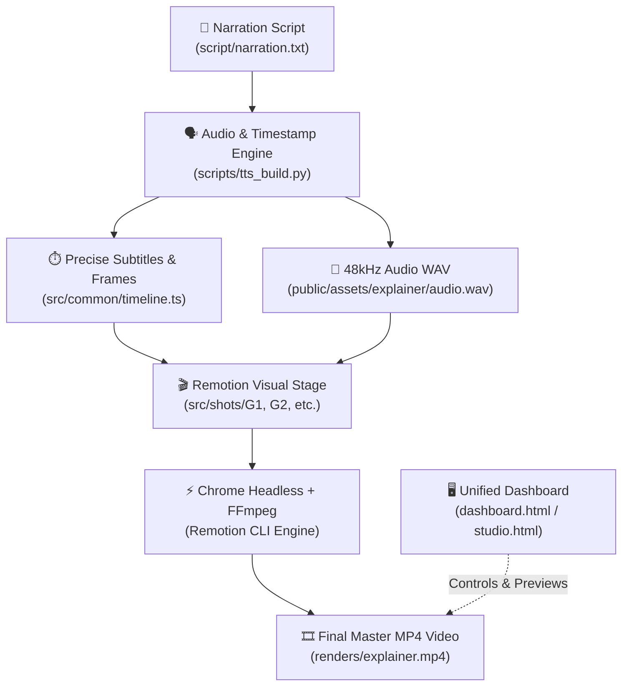

<div align="center">



# 🎬 AI Creative Studio
### Autonomous "Video-as-Code" Motion Graphics & Audio Synthesis Engine

[](https://www.typescriptlang.org/)
[](https://www.remotion.dev/)
[](https://react.dev/)
[](https://python.org/)
[](LICENSE)

<br/>



<br/>
<br/>

**Turn a script into a fully narrated motion-graphics explainer video.**
*Every frame is drawn programmatically in code using Remotion, synchronized with high-quality neural voiceovers and subtitle timing.*

</div>

---

## 🌍 Overview

AI Creative Studio is a workflow for generating short explainer videos from plain text narration. It combines:

- Remotion + React for code-driven motion graphics
- Python + Edge TTS for speech synthesis
- subtitle/timeline generation from narration text
- a browser-based control panel for editing and previewing
- a local workflow runner for render automation

This project is designed for content creators, product teams, or builders who want to create cinematic explainer videos from scripts without manually animating every frame.

---

## ✨ Key Features

### 1. 🎥 Code-Driven Motion Graphics ("Video as Code")
- Built on **Remotion 4** and **React 19**.
- Creates animations with components, SVG, CSS, and timing logic.
- Uses deterministic frame generation for predictable output.
- Includes animated background layers, graph overlays, waveform motion, and HUD-style visuals.

### 2. 🗣️ Neural Voiceover & Subtitle Alignment
- Integrates with **Edge TTS**, **Soundfile**, and **NumPy**.
- Generates narration audio and timing metadata automatically.
- Writes subtitle blocks and chapter timing to generated files in `src/common` and `script/`.
- Supports multilingual script input, including **English**, **Chinese**, and other text-driven narration flows.

### 3. 🖥️ Unified Browser Control Dashboard
- A dashboard (`dashboard.html`) and a local studio UI (`studio.html`) let you:
  - edit narration scripts
  - switch voice profiles
  - generate audio and timeline data
  - preview video or render output
  - monitor workflow logs

### 4. ⚡ One-Click PowerShell Workflow Runner
The repository includes a workflow runner for common tasks:

```powershell
.\run.ps1 voice     # Generate voiceover and subtitle timeline
.\run.ps1 studio    # Launch Remotion Studio web preview
.\run.ps1 render    # Render final production MP4
.\run.ps1 preview   # Render a short preview
.\run.ps1 typecheck # Check TypeScript compilation
```

### 5. 🎨 Motion Design Rules
Built-in animation logic reflects motion-design principles such as:
- natural easing curves
- strong visual hierarchy
- paced scene transitions
- subtle UI polish and glow effects

### 6. 🧩 Multi-Language & International-Friendly Design
This project is intentionally prepared for international text workflows:
- script text can contain English and Chinese content
- subtitle splitting uses `|` for caption chunks
- timeline generation supports different text language patterns
- the codebase is organized for future multilingual audio and subtitle expansion

> Note: if you see garbled characters on Windows, make sure the file is saved as **UTF-8** and the editor/viewer is using UTF-8 encoding. This project was written with Unicode-safe text handling for languages like Chinese and other non-English scripts.

---

## 🏗️ Architecture & Pipeline Flow



---

## 📁 Repository Structure

```text
AI_CREATIVE_STUDIO_HUB/
├── assets/                     # README images and preview assets
│   ├── demo.gif                # animated demo showcase
│   └── logo.png                # studio icon
├── dashboard.html              # browser-based control dashboard
├── studio.html                 # local workflow UI for script + render controls
├── studio-server.mjs           # local Node server to power workflow actions
├── public/                     # static assets for generated output
│   └── assets/explainer/       # generated voice and related media
├── script/                     # narration and generated timeline metadata
│   ├── narration.txt            # source story/script with chapter markers
│   ├── timeline.json            # generated timing metadata
│   └── timeline.md             # timeline summary for human review
├── scripts/
│   └── tts_build.py            # voice synthesis + subtitle timing pipeline
├── src/                        # video-as-code compositions and shared code
│   ├── config.ts               # core video metadata
│   ├── Root.tsx                # Remotion root registration
│   ├── Main.tsx                # stage and composition orchestration
│   ├── index.ts                # Remotion entry point
│   ├── common/                 # shared visual and subtitle helpers
│   ├── overlay/                # overlay scenes and HUD layers
│   └── shots/                  # animated shot modules (G1, G2, G3, ...)
├── .gitignore                  # repo ignore rules
├── LICENSE                     # MIT license
├── package.json                # Node dependencies and scripts
├── run.ps1                     # PowerShell workflow runner
├── remotion.config.ts          # Remotion engine config
├── studio.ico                  # studio app icon
├── tsconfig.json               # TypeScript config
├── README.md                   # project documentation
└── renders/                    # final and preview MP4 files
```

---

## 🚀 Quick Start Guide

### 1. Prerequisites
Make sure these are installed:

- **Node.js**: v20 or v22 LTS
- **Python**: 3.10+
- **FFmpeg**
- **Git**
- **PowerShell** (Windows) or a compatible shell

### 2. Installation

```powershell
# Clone the repository
git clone https://github.com/engineerpk38-rgb/AI_CREATIVE_STUDIO_HUB.git
cd AI_CREATIVE_STUDIO_HUB

# Install Python audio prerequisites
pip install edge-tts soundfile numpy

# Install Node dependencies
npm install
```

### 3. Local Studio Workflow

```powershell
node .\studio-server.mjs
```

Then open:

```text
http://127.0.0.1:4173
```

This gives you the local app UI for:
- editing narration
- selecting voice
- generating audio and subtitle timeline
- rendering preview or final video
- reviewing workflow logs

### 4. Traditional Workflow

#### Step A: Write Your Narration Script
Open `script/narration.txt` and write your script.

Use `# CHAPTER` to start a chapter and `|` to split subtitle chunks:

```text
# CHAPTER 1 Pipeline Overview
Welcome to the autonomous AI video studio, | where code and narration come together.
Every graphic is rendered programmatically, | synchronized with crystal-clear audio.

# CHAPTER 2 Audio and Motion Sync
Text-to-speech voiceovers generate precise timestamps, | aligning subtitles down to the exact frame.
From concept to finished MP4 video, | the entire workflow runs completely in code.
```

#### Step B: Generate Voice & Subtitle Timestamps

```powershell
.\run.ps1 voice
```

#### Step C: Preview in Remotion Studio

```powershell
.\run.ps1 studio
```

Then open the local URL shown by Remotion, usually `http://localhost:3000`.

#### Step D: Render Final Video

```powershell
.\run.ps1 render
```

Your final video will be generated in:

```text
renders/explainer.mp4
```

---

## 🌐 Multilingual Notes

This project is intentionally designed for international and multilingual storytelling.

- English narration works naturally with the default voice system.
- Chinese narration is supported via the script language detection and subtitle generation pipeline.
- Subtitle timing is derived from narration and can be tuned by splitting text with `|` for shorter caption chunks.
- If you are editing in a non-English language, save files as UTF-8 to avoid garbled text.

This is especially important for scripts containing characters such as:
- Chinese
- Arabic
- accented European characters
- emoji and symbols

---

## 🧠 Real Workflow Notes

The project now includes a local workflow server, `studio-server.mjs`, which adds a simple app layer around the PowerShell actions. This improves the experience by letting you:

- save narration changes in one place
- choose a voice
- trigger generation tasks
- monitor logs in real time
- preview outputs without re-opening the terminal each time

---

## 📄 License
This project is open-source under the [MIT License](LICENSE).

---

<div align="center">
  <b>Built with ❤️ by Ali Hassan using Remotion, EdgeTTS, and AI-powered motion graphics workflows.</b>
</div>

---

## 🛠️ Troubleshooting

### Garbled characters / weird symbols
If text looks broken, do this:

1. Open the file in VS Code or another editor.
2. Set encoding to **UTF-8**.
3. Re-save the file.
4. Make sure Git is not converting line endings unexpectedly.

### PowerShell path errors
If you get a path problem like a space in your Windows username, use quotes:

```powershell
cd "C:\Users\ALI HASSAN\Desktop\AI_CREATIVE_STUDIO_HUB-main\AI_CREATIVE_STUDIO_HUB-main"
```

### Missing dependency errors
If the repo says a tool is missing:

```powershell
npm install
pip install edge-tts soundfile numpy
```

and confirm that FFmpeg is installed and available in `PATH`.

---

If you want, I can also update the README into a more polished portfolio version with a stronger product pitch and screenshot sections.


